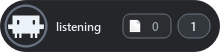
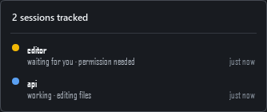
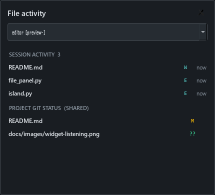

<h1 align="center">Blinkdock</h1>

<p align="center"></p>

<p align="center"><em>Stay in flow. Know when Claude needs you.</em></p>

Blinkdock shows when Claude Code is working, waiting for you, finished, or in an error state. It can track several sessions at once, open the right terminal when a session was started with its launcher, and show which files a session edited. Claude Code continues to run in your terminal; the widget observes its hooks and does not replace the CLI. It currently supports local Claude Code CLI sessions on Windows, not other agents or Claude's web/desktop sessions. The application still uses its former Claude Island name in some commands and data paths while the rebrand is in progress.

The project is currently distributed as Python source, not as a packaged Windows installer. It does **not** let you approve permissions or type responses inside the widget: return to the terminal to do that.

| Working | Waiting for input |
| :---: | :---: |
|  |  |

The previews are captured from the real PySide6 interface with sample sessions. The colored ring and expansion animate in the running application.

## Get started

**Requirements:** Windows 10 or 11, Python 3.10 or newer, and an installed, signed-in [Claude Code CLI](https://code.claude.com/docs/en/overview). Windows Terminal is recommended for precise session-to-window switching. Git is optional; it is only needed for the project's Git-status view.

1. Download this repository as a ZIP and extract it, or clone it, then open a terminal in its folder:

   ```powershell
   git clone https://github.com/benmaster82/Blinkdock.git
   cd Blinkdock
   ```
2. Install the Python dependency using the same `python` command you will use to run the app:

   ```powershell
   python -m pip install -r requirements.txt
   ```

3. Double-click **`Install.cmd`**, or run `python setup.py`. This installs Claude Code hooks in `%USERPROFILE%\.claude\settings.json`, enables launch at Windows sign-in, and starts the widget now. Existing settings are preserved and an existing `settings.json` is backed up as `settings.json.bak`.
4. Open Claude Code normally with `claude`. The widget reacts to its next observed event. A session already open during installation may need another tool call or a restart before it appears.

The installer does not modify the `claude` command or `PATH`, and administrator rights are not required. Re-run **`Install.cmd`** after updating this project so the hook commands reflect the current code and path.

To start the already-installed widget manually, double-click **`Start Island.cmd`**. Only one instance can run at a time. To stop it for this sign-in session, use **Quit** in the tray or right-click menu; autostart remains enabled until you uninstall or disable it.

## Everyday use

The widget stays near the top of the screen. Compact states show a status label; states that need attention expand. The number on the right counts tracked sessions, and the file badge counts unique files touched by their successful `Edit` and `Write` tool calls.

| Action | Result |
| --- | --- |
| Click the session count | Open the session list, ordered by urgency. Each row shows project, state, detail, and time since its last event. |
| Click the file badge | Open file activity. Choose a session to see its edits and the shared Git status of its project. |
| Click the widget body | With multiple sessions, open the list. With one session, focus its terminal when possible. |
| Drag the widget | Move it horizontally; its position is remembered. |
| Double-click the body | Hide the widget to the system tray. |
| Click the tray icon | Show or hide the widget. Right-click the tray icon for Show/Hide, Forget inactive sessions, and Quit. |
| Right-click the widget | Simulate a state for testing, forget inactive sessions, or quit. |

<p align="center">
  
  
</p>

These two panels also use sample data. The Git section is **project-wide**, not attributed to the selected Claude session.

### What the states mean

| State | Visual feedback | Observed event or condition |
| --- | --- | --- |
| Offline | Small, gray | No tracked session, or a session ended. |
| Listening | Small, muted | A session started and is ready for a prompt. |
| Working | Small, blue breathing ring | Prompt submitted, tool activity, or work resumed. Tool detail may say reading, editing, running a command, and so on. |
| Background work | Expanded, teal | Claude stopped its foreground turn while background tasks were still reported. |
| Waiting for you | Expanded, amber pulse; optional chime | A foreground permission request, supported notification, or MCP input needs attention. |
| Done | Expanded, green | Claude stopped with no reported background tasks. Returns to Listening after about three seconds. |
| Error | Expanded, red | An API/stop failure or a quota resume that cannot proceed. |
| Status unknown | Expanded, gray | No fresh event for long enough, or an interrupted tool. The widget does not claim Claude is still working. |

The widget reports the **last observable hook event**, not a guarantee of Claude's internal state. A manual interruption, denied prompt, or background completion may not have a matching follow-up event; the next event corrects the display, or the state eventually becomes **Status unknown**.

### Multiple sessions and terminal focus

Hooks are installed globally by the easy installer. Each Claude Code session has its own local state file, so parallel sessions do not overwrite one another. The widget displays the most urgent active state: Waiting, Error, Working, Done, Background work, Status unknown, then Listening. A new waiting session sounds the chime even if another session is already waiting. The count includes sessions whose status is unknown, because their end was not observed.

For **reliable return to the correct terminal**, start a session through the optional Windows Terminal launcher:

```powershell
python launch_claude.py C:\path\to\project
```

When `wt.exe` is available, the launcher opens Claude Code in a dedicated Windows Terminal window and links that window to its session. Linked rows in the session list show a focus arrow; click the row to raise that exact window. Without Windows Terminal, the launcher starts Claude Code without an exact-focus link. Sessions started with plain `claude` are still monitored, but their rows cannot offer exact focus. With a single unlinked session, clicking the widget attempts a best-effort terminal focus, which may pick the wrong window if several are open. No text or approval is sent to Claude by the widget.

### File activity

The file panel separates two sources of information:

- **Session activity:** successful direct Claude Code `Edit` and `Write` calls, recorded by absolute path. A current file-tool call can appear as pending until it succeeds. The same file is counted once per session, and the panel shows up to 100 recent files for the selected session.
- **Project Git status (shared):** modified, added, deleted, renamed, and untracked files reported by `git status` for the selected session's working directory. This can include your own edits, shell commands, and changes from other sessions. It is never presented as proof that this particular Claude session made a change.

Git runs asynchronously **only while the file panel is open**, approximately every two seconds; it does not run in Claude's hooks. Non-Git folders still show session activity. File history is local and is removed when that session ends. The badge is not a count of every Git change: indirect edits made through `Bash` or another tool are visible only in shared Git status, not attributed to a session.

## Other ways to run

| Mode | Command | What it does |
| --- | --- | --- |
| Normal install | `Install.cmd` or `python setup.py` | Hooks, autostart, and widget. |
| Manual widget | `python island.py` | Run the UI in a terminal, useful for development; hooks must be installed separately to receive events. |
| Windowless widget | `Start Island.cmd` | Start the UI with `pythonw`, without a console. |
| Visual demo | `python demo.py` | Cycle through sample states without Claude Code; run the widget in another terminal first. Stop with Ctrl+C. |
| Exact-focus Claude session | `python launch_claude.py [project-folder]` | Open a linked Windows Terminal session; hooks still need to be installed. |
| Uninstall | `Uninstall.cmd` or `python setup.py uninstall` | Remove this app's global hooks and autostart entry, then stop the widget. |

If you want hooks for **one project only**, use the manual installer instead of `Install.cmd`:

```powershell
python install_hooks.py C:\path\to\project\.claude\settings.json
python island.py
```

For global hooks without autostart, replace the project path with `%USERPROFILE%\.claude\settings.json`. `install_hooks.py` merges with existing hooks and backs up an existing settings file. Run `python install_hooks.py remove <path-to-settings.json>` to remove only this project's hook commands from that file. Running `python install_hooks.py` with no path prints the JSON block for manual inspection or installation. `python install_autostart.py` enables autostart separately; `python install_autostart.py off` disables it. Manual project-scoped hooks are **not** removed by `Uninstall.cmd`, which only targets the global settings file.

## Configuration

Preferences live at `%LOCALAPPDATA%\claude-island\settings.json`. The file is created as needed; missing keys use these defaults:

| Key | Default | Purpose |
| --- | --- | --- |
| `center_x` | `null` | Horizontal center in screen pixels. `null` centers automatically; dragging updates it. |
| `top_margin` | `12` | Distance from the top of the available screen area, in pixels. |
| `chime` | `true` | Play a Windows notification sound when a new session needs attention. |
| `working_timeout` | `240` | Seconds without a new event before Working becomes Status unknown. |
| `focus_title` | `Claude Code` | Last-resort terminal title match for best-effort focus. |

The same directory holds `sessions\*.json` (one state per session), `activity-*.json` (recorded file activity), `terminal.json` (a remembered terminal window handle), and `settings.lock` (the single-instance guard). Session files are removed on `SessionEnd`; if that event is missed, **Forget inactive sessions** removes records whose last event is over an hour old. Waiting, Error, Background work, and Listening also change to Status unknown after an hour of silence; Working uses `working_timeout`.

## How it works

Claude Code hook -> `hook_bridge.py` -> per-session JSON -> `island.py` -> widget. Each hook runs a short `pythonw` command, reads Claude's event payload, and atomically writes one local state file. Successful direct file edits also write small per-session activity records. The UI polls those files; it does not inspect Claude's private process or alter its command. The file panel alone starts `git status`, in a separate process when visible.

| Claude Code hook | Widget result |
| --- | --- |
| `SessionStart`, `SessionEnd` | Listening; remove ended session. |
| `UserPromptSubmit`, `PreToolUse`, `PostToolUse` | Working. |
| `PostToolUseFailure` | Working, or Status unknown if explicitly interrupted. |
| `PermissionRequest`, `Elicitation` | Waiting for you; background-agent permission requests are not treated as a foreground prompt. |
| `PermissionDenied`, `ElicitationResult` | Working again. |
| `Notification` | Waiting, Working, or Error for supported notification types; informational notifications are ignored. |
| `Stop`, `StopFailure` | Done or Background work; Error on stop failure. |

Supported waiting notifications include permission prompts, MCP dialogs, agent input requests, and stale quota resumes. Elicitation completion and automatic quota resume return to Working; a disabled quota resume becomes Error. The bridge validates the notification type in the event payload before changing state. Hook names and payloads can vary between Claude Code versions, so behavior may require adjustment after an upstream change.

| File | Responsibility |
| --- | --- |
| `island.py` | Widget, session aggregation, animation, tray, interaction, and focus controls. |
| `hook_bridge.py`, `install_hooks.py` | Translate events and install/remove Claude Code hook entries. |
| `file_activity.py`, `file_panel.py` | Per-session file records and on-demand shared Git view. |
| `config.py`, `winfocus.py` | Shared state/settings and Windows terminal focus. |
| `setup.py`, `install_autostart.py`, `launch_claude.py` | Installation, sign-in startup, and linked session launcher. |

Tests: `python -m unittest discover -s tests -q`. Documentation previews can be regenerated with `python tools/render_readme_previews.py`; that script uses isolated sample data and does not connect to live Claude sessions.

## Troubleshooting

| Problem | Check |
| --- | --- |
| Nothing appears | Look for the tray icon; click it to show the widget. Or start it with `Start Island.cmd`. A second launch does not create another instance. |
| The widget never changes state | Re-run `Install.cmd` after moving or updating the repository. Check `%USERPROFILE%\.claude\settings.json` for the installed hook commands, then start a new Claude Code session or trigger a tool event. |
| A console flashes for every hook | Re-run the hook installer so commands point to `pythonw.exe`; verify that your Python installation includes it. |
| Click raises the wrong terminal | Use `launch_claude.py` and click its linked row in the session list. Ordinary sessions only have best-effort single-session focus. |
| Files are missing from session activity | Only successful direct `Edit`/`Write` calls are attributed. Check the shared Git section for changes from commands or other processes. |
| Git status is unavailable | Install Git and ensure it is on `PATH`, or check that the session's working directory is a Git repository. Session activity works without Git. |
| A session remains after Claude closes | Its `SessionEnd` hook may not have run. The state eventually becomes unknown; use **Forget inactive sessions** after an hour. |

## Uninstall and project status

Double-click **`Uninstall.cmd`**, or run `python setup.py uninstall`. This removes the app's hooks from the global Claude Code settings, disables per-user autostart, and stops the widget. Other Claude Code hooks and the `claude` command remain intact. Project-scoped hooks installed manually must be removed manually as described above. Local preference/activity files are not deleted by the uninstaller.

**Name and license:** Blinkdock is released under the [MIT License](LICENSE). Some commands and data paths still use the former Claude Island name. The bundled `assets/clawd.png` is derived from [LobeHub Icons](https://github.com/lobehub/lobe-icons/blob/master/packages/static-svg/icons/claudecode.svg) and is covered by its separate [MIT license notice](assets/LICENSE.lobehub). Claude and Claude Code are trademarks of Anthropic. This is an independent project, not affiliated with or endorsed by Anthropic.
